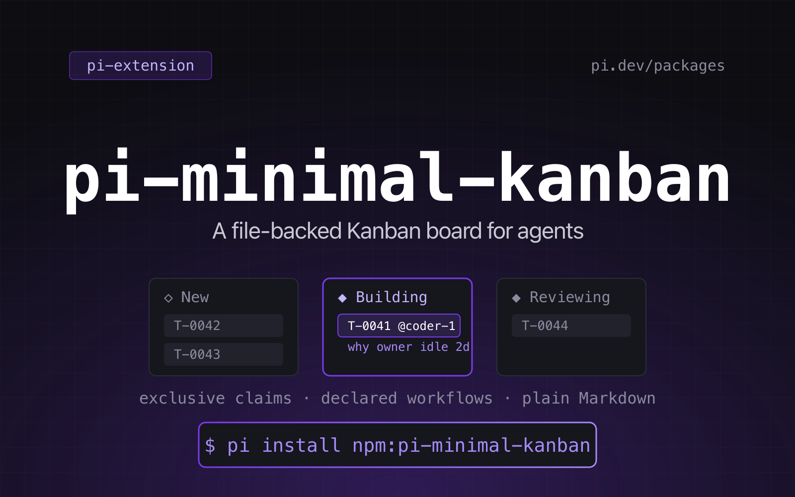
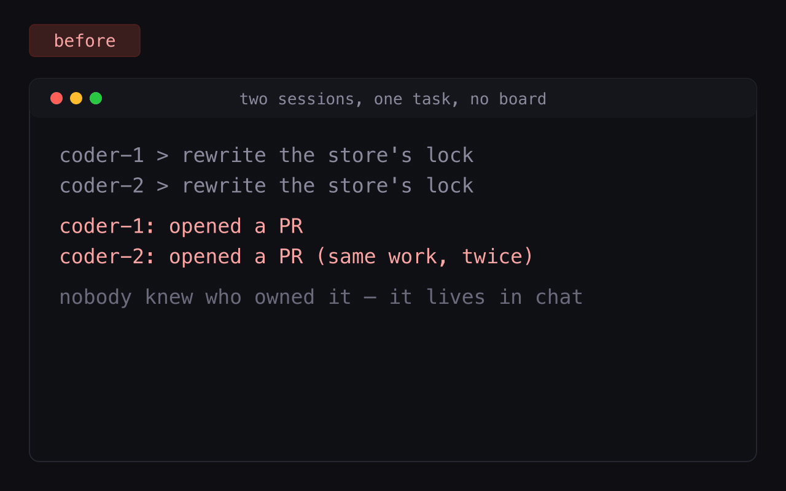

# pi-minimal-kanban

English | [简体中文](./docs/README.zh-CN.md)

<p align="center">
  
</p>

**Pi extension that gives a whole team of agents one shared, file-backed Kanban board**: project-declared
workflows, exclusive task claims, and Markdown tasks you can diff and commit. No database, no server,
no daemon.

[](https://github.com/tychenjiajun/pi-minimal-kanban/actions/workflows/ci.yml)
[](./LICENSE)
[](https://pi.dev/packages/pi-minimal-kanban)
[](https://pi.dev/docs/latest/extensions)

```bash
# works today, straight from the repository
pi install git:github.com/tychenjiajun/pi-minimal-kanban
# once it is published to npm
pi install npm:pi-minimal-kanban
```

Several agents share one project's work without stepping on each other:

- **Project-specific workflows.** Each project declares its own statuses and
  transitions in `.pi/kanban/workflow.yaml` — from `new → done` to a seven-stage
  pipeline.
- **Exclusive claims.** A task has at most one assignee. Moving a task into an
  `active` status claims it; another agent cannot move or release it without
  `force`, and a forced takeover can carry the `reason` that makes it auditable.
- **Files only.** No database, no server, no daemon. Tasks are Markdown files
  you can read, diff, and commit.
- **Minimal UI.** Five tools and one read-only `/kanban` command that renders plain text.

<p align="center">
  
</p>

## Install

```bash
pi install git:github.com/tychenjiajun/pi-minimal-kanban
# or from the npm registry, once published:
pi install npm:pi-minimal-kanban
```

While developing, load it from a checkout:

```bash
pi --extension ./src/index.ts
```

A running session keeps the code it loaded at start-up: after editing the
extension, `/reload` or restart before judging a change from the tools. Tests
and direct module calls always see the working tree.

## Quick start

```bash
/kanban init          # writes .pi/kanban/workflow.yaml
```

Then, from an agent session:

> Create a kanban task for "Add retry to the upload client" and move it to
> working.

The agent calls `kanban_create` and `kanban_move`, and the board looks like:

```
/Users/me/app/.pi/kanban

  ◇ new ────────────────────────────────────────────────────────────────── 0
    (empty)

  ◆ planning ───────────────────────────────────────────────────────────── 0
    (empty)

  ◆ working ────────────────────────────────────────────────────────────── 1
    T-0001  Add retry to the upload client                   @coder-1  rev 2

  ◆ reviewing ──────────────────────────────────────────────────────────── 0
    (empty)

  done ···························································· 0

  1 task · 1 open · 0 done · 1 claimed
```

## Tools

| Tool | Purpose |
|---|---|
| `kanban_create` | Create a task in the workflow's initial status. |
| `kanban_move` | Move along a declared transition; entering an active status claims it. `reason` annotates a forced takeover. |
| `kanban_comment` | Append a Markdown comment. |
| `kanban_assign` | Set or clear the single assignee; assigning to any handle but your own needs `force`, and `reason` annotates a forced write. |
| `kanban_list` | List tasks (paged), read one task in full, print counts, or print the board briefing. |

Every tool takes an `agent` handle (except `kanban_list`) and returns
`structuredContent` for codemode scripts and other extensions. Mutations also
emit `kanban:task_changed` on `pi.events` with `{ project, board, taskId, action }`.

A failure returns `{ ok: false, code, error, hint, root, dir }`; `code` is a
stable string such as `wrong_owner`, `stale`, or `no_workflow`, and `hint` is an
actionable sentence. `kanban_move` takes an optional `expectedRev`: pass the
`rev` you last read to fail instead of overwriting another agent's write.

### Listing and paging

`kanban_list` rows show `id`, `status`, `title`, `@assignee`, and `rev`, ordered
by workflow status then task id. To keep a large board cheap:

| Parameter | Default | Meaning |
|---|---|---|
| `limit` | `50` (max `500`) | Maximum rows printed. |
| `offset` | `0` | Rows to skip after filtering and sorting. |
| `summary` | `false` | Per-status counts instead of rows. |
| `briefing` | `false` | The board briefing instead of rows; wins over every other parameter. |

An incomplete page says how many rows were omitted and which `offset` continues
it, and `structuredContent` carries `total`, `offset`, `limit`, `returned`, and
`hasMore` so a script can page without counting text lines. `total` is always
the post-filter count, including on a briefing, so `briefing: true` on a large
board never looks empty. The workflow block is
always printed, and its size follows the workflow rather than the board.

On a board with no tasks, the list *is* the briefing: the claim rules, the
self-asserted handle convention, and the first calls to make. A task file that
cannot be read is not an empty board: the briefing then prints the warning and
the file it could not read.

## The `/kanban` command

```
/kanban                     the board
/kanban T-0007              one task in full
/kanban --all               expand terminal columns
/kanban --json              machine-readable board
/kanban init                create .pi/kanban/workflow.yaml
/kanban validate            check the workflow and task claims
/kanban validate --stale 12h  warn about claims older than 12h
/kanban status <id>         only tasks in one status
/kanban mine <handle>       only tasks assigned to a handle
```

Rendering is plain text in the transcript — scrollable and copyable, and it works
in headless and RPC modes. **Every subcommand reads.** No `/kanban` form writes to
the board: mutations belong to the five tools, so the command is always safe to
run in a review, a demo, or a read-only session. Clearing a claim, for example,
is `kanban_assign {task: "T-0003", assignee: null, force: true}`.

`/kanban help` (or `/kanban --help`) prints a 14-line card, not a manual: the
claim rule (moving into an active `◆` status claims the task for your handle),
that a terminal status releases the claim and a claim never expires on its own,
that handles are self-asserted names the board does not verify, that assigning a
task to another handle needs `force: true`, that the command only reads and the
`kanban_*` tools write, and where completions look.

Tab completion lists the subcommands, the task ids on this session's board (with
status and title), and the handles the board has seen — up to 20 task ids and 10
handles, scanned from the first 500 task files; with no board it completes only
the subcommands.

`/kanban validate` also reports a task whose frontmatter `id` disagrees with its
filename, an unreadable task file (`unreadable_task`), and a `counter.json` value
that would reissue an existing task id. `/kanban validate` reports those two but
never fixes them, because the command does not write: rename the file to the id
its frontmatter declares (never the reverse — an issued id is never discarded)
and raise a low counter by hand, never lower it. A `T-0007` mentioned in a
description or a comment stays as written: prose is not rewritten.

A claim older than the threshold (24 h by
default, overridable with `--stale` or `PI_KANBAN_STALE_MS`, alias
`PI_KANBAN_STALE_CLAIM_MS`) is a
`stale_claim` **warning**: it is reported but keeps the board valid. An
assignment older than the threshold in a non-active status is the same warning,
worded as an assignment — it is what blocks the move that would create a claim.
A forced takeover that carries no `reason` is a `unannotated_forced`
**warning**: `kanban_assign` and `kanban_move` accept `reason` with `force`, and
a takeover recorded before 0.3.0 stays valid — it just becomes visible.

## Claim age and releasing a claim

Wherever an assignee appears, its claim age is shown — `@coder-1 3d` in task
rows, `/kanban mine`, `/kanban status`, and `/kanban <id>` as
`assignee  coder-1  (claimed 3d)`. Every one of those lists uses the same row
shape, so `rev` is visible too. The age only exists inside an `active` status;
an assignee in any other status is an assignment, not a claim, and has no age.

A claim never expires on its own. When its owner has gone quiet:

- From an agent: `kanban_assign {task: "T-0003", assignee: null, force: true}`
  clears the claim, records the unassignment in history, and bumps `rev`.
- `/kanban` shows the claim and its age; it never clears one. A stale claim is
  reported by `/kanban validate`, and released by that tool call.

## Assignment is exclusive, and third-party assignment is forced

A task has at most one assignee, and **any write to an assignee that is not your
own handle needs `force: true`** — taking another handle's task, assigning a
task nobody holds to a third handle, or handing your own task to somebody else.
A forced write is recorded as `force-assign` + `forced: true` (plus an optional
`reason`), so history tells a takeover from a self-claim; assigning a task to
yourself on an unassigned task needs no `force` and records a plain `assign`.
The rule is ADR [0009](docs/adr/0009-third-party-assignment-is-forced.md), and
the refusal reuses the `wrong_owner` code.

## Where the board lives

The board is `<project>/.pi/kanban/`, where `<project>` is the nearest ancestor of
the working directory that contains `.git` or an existing `.pi/kanban/`.
Override the board directory with `PI_KANBAN_DIR`, or pass `project` to a tool.

Boards are meant to be committed to git so the work travels with the code. Two
agents in **separate worktrees** have separate boards and will not see each
other's claims.

## Workflow

```yaml
name: feature work
initial: new

statuses:
  - id: new
  - id: planning
    active: true
  - id: working
    active: true
  - id: reviewing
    active: true
  - id: done
    terminal: true

transitions:
  new: [planning, working]
  planning: [new, working]
  working: [planning, reviewing]
  reviewing: [working, done]
  done: [working]
```

A shorter linear form works too, and makes the last status terminal:

```yaml
statuses: [new, working, done]
```

Missing or invalid workflows are hard errors for mutations, and `/kanban`
explains what to fix. See [docs/workflow.md](docs/workflow.md) for every rule and
the JSON form.

## Files

```
.pi/kanban/
├── workflow.yaml      the lifecycle (or workflow.json)
├── counter.json       next task id
├── tasks/
│   ├── T-0001.md      one Markdown file per task
│   └── T-0002.md
└── .lock/             transient lock directory
```

Task files are documented in [docs/task-file.md](docs/task-file.md).

## Skills and prompts

The package ships two skills and two prompt templates beside the extension, so an
installed board arrives with the conventions its agents need. Each covers one
role and points at the references rather than repeating them.

**Skills** — loaded by the model when their description matches (or forced by a
human with `/skill:<name>`):

- `skills/kanban/SKILL.md` — the working agreement: read the board with
  `kanban_list` before claiming, claim by moving into an `active` status, carry a
  `reason` on a takeover, and comment when you stop. `skills/kanban/references/`
  holds the coordination and workflow-authoring details it points at.
- `skills/kanban-setup/SKILL.md` — the **maintainer** role: author
  `.pi/kanban/workflow.yaml` for the real project with ordinary file tools, check
  it by listing the board, and commit it. Load it when a project needs its first
  board or when kanban calls fail because the workflow is missing or invalid.

**Prompt templates** — typed by a human as `/review`, `/standup`; Pi expands the
body and hands it to the agent, so each body is written for the agent to perform
with tools, never as a command for it to run:

- `prompts/review.md` — the **reviewer** role: clear the tasks in the project's
  review-like statuses, review the actual change, comment the verdict, and move
  each task to where it belongs. It respects `wrong_owner` instead of forcing
  other agents' claims.
- `prompts/standup.md` — the **handoff** step: report what each handle holds, what
  has gone stale, and what is waiting, for a handle or the whole board.

Together they cover the loop: set the board up, work and claim tasks, review them,
and stand up. Every one reads from the board (`kanban_list`) rather than from
memory, and none hand-edits `status` or `assignee`.

All live at conventional paths, are declared in `package.json` (`pi.skills`,
`pi.prompts`) and shipped in the tarball (`files`), so `pi install` discovers them
with no project-side copying.

## Design notes

- [GLOSSARY.md](GLOSSARY.md) — board, workflow, status, task, claim.
- [docs/adr/](docs/adr/) — why the board lives in the repo, why workflows are
  declared, why tasks are Markdown, why claims are part of the state machine.
- [docs/product/](docs/product/) — the product audit and backlog behind 0.2.0,
  0.3.0, and 0.4.0, the design spec for the tool surface, and the scope decisions,
  including what was deliberately deferred.
- [CHANGELOG.md](CHANGELOG.md) — what changed in each release.
- [pi.dev/packages/pi-minimal-kanban](https://pi.dev/packages/pi-minimal-kanban) — the gallery page.
- [pi packages documentation](https://pi.dev/docs/latest/packages) — how Pi extensions are packaged.

## FAQ

### What does pi-minimal-kanban do?
It gives Pi agents a shared Kanban board stored as files in your repository: agents create tasks, claim
them by moving them into an active status, and see who owns what before starting. It is a coordination
primitive, not a project tracker with a UI.

### How is this different from a todo list in the prompt?
A todo list lives in one agent's context and dies with the session. The board lives in the repository:
it survives sessions, is shared by every agent on the project, and enforces that only one agent holds a
task at a time.

### Do I need multiple agents to use it?
No. One agent plus a human reading `/kanban` is a useful setup. The board earns its keep the moment two
sessions — or two machines — touch the same project.

### What happens when an agent dies holding a task?
Nothing expires on its own, by design: a claim is never released behind its owner's back. `/kanban`
shows the claim's age and `/kanban validate` warns past a threshold (24 h by default); a human or an
agent releases it with `kanban_assign {assignee: null, force: true}`, or another agent takes over with
`force: true` and a `reason`.

### Why require `force` to assign a task to someone else?
Because writing another handle's name is a coordination act the owner never consented to. Self-claims
need no flag; every other assignee write is explicit and lands in history as `force-assign`.

### Can two agents really not corrupt the board?
Every mutation re-reads and rewrites under a short-lived file lock, so two agents racing for a task end
with one winner and one `wrong_owner`. Tasks carry a `rev`; pass `expectedRev` to fail instead of
overwriting a write you did not see.

### How many tasks can it hold?
A 120-task board renders fine; `kanban_list` pages (50 rows by default, 500 max) so a large board never
costs a large context window. A board is a directory of small files, so anything git can handle works.

### Does it work in headless / RPC mode?
Yes. Rendering is plain text in the transcript, and every tool returns `structuredContent` for codemode
scripts and other extensions.

## License

MIT
