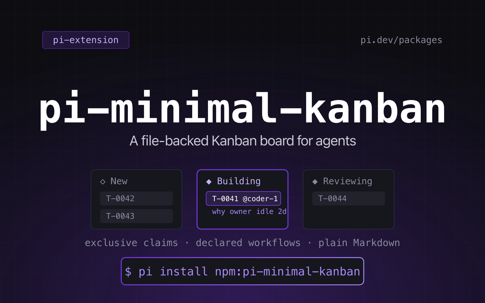
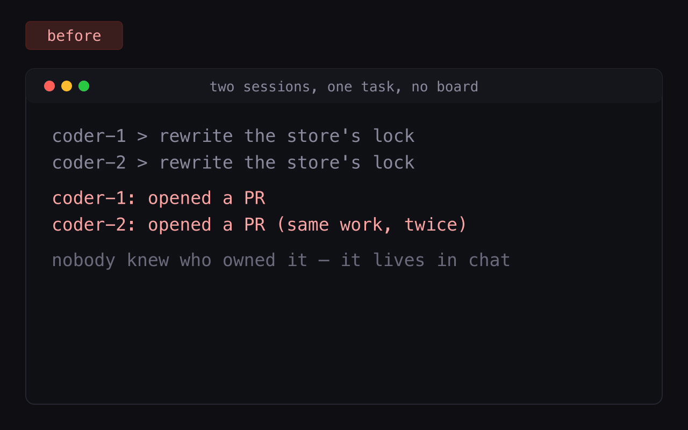

# pi-minimal-kanban

[English](../README.md) | 简体中文

<p align="center">
  
</p>

**一个 Pi 扩展，为整支代理团队提供一块共享的、文件驱动的看板**：项目自定义的工作流、
独占的任务认领，以及可以 diff、可以提交的 Markdown 任务。没有数据库，没有服务端，
没有守护进程。

[](https://github.com/tychenjiajun/pi-minimal-kanban/actions/workflows/ci.yml)
[](../LICENSE)
[](https://pi.dev/packages/pi-minimal-kanban)
[](https://pi.dev/docs/latest/extensions)

```bash
# 现在就能从仓库直接安装
pi install git:github.com/tychenjiajun/pi-minimal-kanban
# 发布到 npm 之后
pi install npm:pi-minimal-kanban
```

多个代理共享同一个项目的工作，而不会互相踩踏：

- **项目专属工作流。** 每个项目在 `.pi/kanban/workflow.yaml` 中声明自己的状态与
  状态间允许的迁移 —— 从 `new → done` 两段，到七阶段的流水线。
- **独占认领。** 一个任务最多只有一个执行者。把任务移入 `active` 状态即完成认领；
  其他代理不经 `force` 无法移动或释放它，而强制接管可以附带 `reason`，让这次接管可审计。
- **只有文件。** 没有数据库、没有服务端、没有守护进程。任务是 Markdown 文件，
  可以阅读、可以 diff、可以提交。
- **极简 UI。** 五个工具 + 一个只读的 `/kanban` 命令，输出为纯文本。

<p align="center">
  
</p>

## 安装

```bash
pi install git:github.com/tychenjiajun/pi-minimal-kanban
# 或从 npm registry 安装（发布之后）：
pi install npm:pi-minimal-kanban
```

开发时，可以从本地 checkout 加载：

```bash
pi --extension ./src/index.ts
```

运行中的会话会一直使用启动时加载的代码：修改扩展后，请 `/reload` 或重启，
再去评判工具的行为变化。测试和直接调用模块则始终看到工作区的最新代码。

## 快速上手

```bash
/kanban init          # 写入 .pi/kanban/workflow.yaml
```

然后在代理会话中说：

> 给「给上传客户端加重试」建一个 kanban 任务，并把它移到 working。

代理会调用 `kanban_create` 和 `kanban_move`，看板看起来是这样：

```
/Users/me/app/.pi/kanban

  ◇ new ────────────────────────────────────────────────────────────────── 0
    (empty)

  ◆ planning ───────────────────────────────────────────────────────────── 0
    (empty)

  ◆ working ────────────────────────────────────────────────────────────── 1
    T-0001  给上传客户端加重试                                @coder-1  rev 2

  ◆ reviewing ──────────────────────────────────────────────────────────── 0
    (empty)

  done ···························································· 0

  1 task · 1 open · 0 done · 1 claimed
```

## 工具

| 工具 | 用途 |
|---|---|
| `kanban_create` | 在工作流的初始状态中创建任务。 |
| `kanban_move` | 沿已声明的迁移移动任务；进入 active 状态即完成认领。`reason` 用于标注强制接管。 |
| `kanban_comment` | 追加一条 Markdown 评论。 |
| `kanban_assign` | 设置或清空唯一的执行者；把任务指派给非自己的 handle 需要 `force`，`reason` 用于标注强制写入。 |
| `kanban_list` | 分页列出任务、完整读取单个任务、打印计数，或打印看板 briefing。 |

除 `kanban_list` 外，每个工具都接收一个 `agent` handle，并返回 `structuredContent`，
供 codemode 脚本与其他扩展使用。写操作还会在 `pi.events` 上发出
`kanban:task_changed` 事件，携带 `{ project, board, taskId, action }`。

失败时返回 `{ ok: false, code, error, hint, root, dir }`；`code` 是稳定字符串，
例如 `wrong_owner`、`stale`、`no_workflow`，`hint` 是一句可执行的建议。
`kanban_move` 接受可选的 `expectedRev`：传入你上次读到的 `rev`，
就能在别人已写入时失败，而不是默默覆盖。

### 列表与分页

`kanban_list` 的每一行显示 `id`、`status`、`title`、`@assignee` 和 `rev`，
排序依据是工作流中的状态顺序，然后按任务 id。为了不让大看板代价过高：

| 参数 | 默认值 | 含义 |
|---|---|---|
| `limit` | `50`（最大 `500`） | 最多打印的行数。 |
| `offset` | `0` | 过滤与排序后跳过的行数。 |
| `summary` | `false` | 只打印各状态计数，不打印任务行。 |
| `briefing` | `false` | 打印看板 briefing 而非任务行；优先级高于其他所有参数。 |

不完整的页会说明被省略了多少行、以及用哪个 `offset` 继续；
`structuredContent` 中携带 `total`、`offset`、`limit`、`returned` 和 `hasMore`，
脚本无需数文本行即可翻页。`total` 始终是过滤后的计数，briefing 也不例外，
所以在大看板上 `briefing: true` 永远不会看起来是空的。工作流区块始终会打印，
其大小取决于工作流本身，而不是看板大小。

在没有任何任务的看板上，列表**就是** briefing：认领规则、自报 handle 的约定，
以及第一步该调用什么。读不出来的任务文件不等于空看板：briefing 会打印警告
以及它读不了的那个文件。

## `/kanban` 命令

```
/kanban                      看板
/kanban T-0007               完整展示一个任务
/kanban --all                展开终态列
/kanban --json               机器可读的看板
/kanban init                 创建 .pi/kanban/workflow.yaml
/kanban validate             校验工作流与任务认领
/kanban validate --stale 12h 对超过 12 小时的认领发出警告
/kanban status <id>          只看某个状态下的任务
/kanban mine <handle>        只看指派给某个 handle 的任务
```

渲染结果就是对话里的纯文本 —— 可滚动、可复制，在 headless 和 RPC 模式下同样可用。
**每个子命令都是只读的。** 没有任何 `/kanban` 形式会写看板：写操作属于那五个工具，
因此这个命令在任何评审、演示或只读会话里都可以放心执行。例如解除认领就是
`kanban_assign {task: "T-0003", assignee: null, force: true}`。

`/kanban help`（或 `/kanban --help`）打印一张 14 行的卡片，而不是一本手册：
认领规则（把任务移入带 `◆` 的 active 状态即为你的 handle 认领该任务）、
终态会释放认领且认领不会自行过期、handle 是自报名字而看板不做校验、
把任务指派给别的 handle 需要 `force: true`、命令只读而 `kanban_*` 工具负责写，
以及补全项从哪里来。

Tab 补全会列出子命令、当前会话看板上的任务 id（带状态和标题），
以及看板见过的 handle —— 最多 20 个任务 id 和 10 个 handle，
扫描自前 500 个任务文件；没有看板时只补全子命令。

`/kanban validate` 还会报告 frontmatter 中的 `id` 与文件名不一致的任务、
无法读取的任务文件（`unreadable_task`），以及会把已存在的任务 id 重新发出去的
`counter.json` 值。这两项只报告、不修复，因为命令本身不写：把文件名改成
frontmatter 中声明的 id（绝不反过来 —— 已发出的 id 永不复用），
并手工调高偏低的计数器，永不调低。描述或评论中提到的 `T-0007` 保持原样：
正文不会被重写。

超过阈值（默认 24 小时，可用 `--stale` 或 `PI_KANBAN_STALE_MS`，
别名 `PI_KANBAN_STALE_CLAIM_MS` 覆盖）的认领是一个 `stale_claim` **警告**：
它会被报告，但看板依然有效。非 active 状态下超过阈值的指派是同样的警告，
措辞为“指派” —— 而这正是阻塞“制造认领的那次移动”的东西。
没有携带 `reason` 的强制接管是 `unannotated_forced` **警告**：
`kanban_assign` 与 `kanban_move` 都支持在 `force` 时附带 `reason`；
0.3.0 之前记录的接管依然有效 —— 只是变得可见。

## 认领时长与释放认领

凡是出现执行者的地方，都会显示认领时长 —— 任务行里的 `@coder-1 3d`、
`/kanban mine`、`/kanban status`，以及 `/kanban <id>` 中的
`assignee  coder-1  (claimed 3d)`。这些列表共用同一种行格式，所以 `rev` 也一并可见。
时长只存在于 `active` 状态之内；其他状态下的执行者只是“指派”，不是“认领”，没有时长。

认领永不自行过期。当它的持有者早已沉默：

- 由代理操作：`kanban_assign {task: "T-0003", assignee: null, force: true}`
  会清除认领、在历史中记录这次取消指派，并递增 `rev`。
- `/kanban` 只展示认领及其时长，从不主动清除。陈旧的认领会由
  `/kanban validate` 报告，由那次工具调用释放。

## 指派是独占的，第三方指派必须 force

一个任务最多只有一个执行者，而且**任何针对非自己 handle 的指派写入都需要
`force: true`** —— 接管别人的任务、把无人持有的任务指派给第三方 handle，
或把自己的任务交给别人。强制写入会记录为 `force-assign` + `forced: true`
（外加可选的 `reason`），所以历史能区分接管与自领；
在无人持有的任务上把自己指派为执行者无需 `force`，记录为普通的 `assign`。
这条规则见 ADR [0009](adr/0009-third-party-assignment-is-forced.md)，
拒绝时复用 `wrong_owner` 错误码。

## 看板放在哪里

看板位于 `<project>/.pi/kanban/`，其中 `<project>` 是工作目录向上最近的、
包含 `.git` 或已有 `.pi/kanban/` 的祖先目录。可用 `PI_KANBAN_DIR` 覆盖看板目录，
或给工具传入 `project`。

看板本就应该提交到 git，让工作与代码一同流转。位于**不同 worktree** 的两个代理
拥有各自的看板，看不到彼此的认领。

## 工作流

```yaml
name: feature work
initial: new

statuses:
  - id: new
  - id: planning
    active: true
  - id: working
    active: true
  - id: reviewing
    active: true
  - id: done
    terminal: true

transitions:
  new: [planning, working]
  planning: [new, working]
  working: [planning, reviewing]
  reviewing: [working, done]
  done: [working]
```

更短的线性写法同样可用，它会把最后一个状态设为终态：

```yaml
statuses: [new, working, done]
```

缺失或非法的工作流对写操作是硬错误，`/kanban` 会解释要修什么。
完整规则与 JSON 形式见 [workflow.md](workflow.md)。

## 文件结构

```
.pi/kanban/
├── workflow.yaml      生命周期（或 workflow.json）
├── counter.json       下一个任务 id
├── tasks/
│   ├── T-0001.md      每个任务一个 Markdown 文件
│   └── T-0002.md
└── .lock/             短暂的锁目录
```

任务文件的格式见 [task-file.md](task-file.md)。

## Skill 与 prompt

本包在扩展之外还附带一个 skill 和一个 prompt 模板，所以安装后的看板自带代理需要的约定：

- `skills/kanban/SKILL.md` —— 工作约定：认领前先用 `kanban_list` 读看板，
  通过移入 `active` 状态来认领，接管时带上 `reason`，停手时留下评论。
  `skills/kanban/references/` 存放 skill 指向的任务文件、工作流与恢复细节。
- `prompts/standup.md` —— 一个 `/standup` 模板：读取看板，报告每个 handle 持有
  什么、什么已经陈旧、什么在等待。

两者都放在约定路径上，并在 `package.json`（`pi.skills`、`pi.prompts`）中声明、
随 tarball 一同发布（`files`），所以 `pi install` 会自动发现它们，无需在项目侧复制。

## 设计说明

- [GLOSSARY.md](../GLOSSARY.md) —— board、workflow、status、task、claim。
- [docs/adr/](adr/) —— 为什么看板放在仓库里、为什么工作流要声明、
  为什么任务是 Markdown、为什么认领是状态机的一部分。
- [docs/product/](product/) —— 0.2.0、0.3.0、0.4.0 背后的产品审计与 backlog，
  工具面的设计规格与范围决策，包括有意推迟的部分。
- [CHANGELOG.md](../CHANGELOG.md) —— 每个版本的变更。
- [pi.dev/packages/pi-minimal-kanban](https://pi.dev/packages/pi-minimal-kanban) —— 画廊页面。
- [pi packages 文档](https://pi.dev/docs/latest/packages) —— Pi 扩展如何打包。

## FAQ

### pi-minimal-kanban 是做什么的？
它给 Pi 代理一块存储在仓库文件里的共享看板：代理创建任务、通过把任务移入 active 状态
完成认领，并在动手前看到谁拥有什么。它是一个协作原语，而不是带 UI 的项目跟踪系统。

### 它和写在 prompt 里的 todo list 有什么区别？
todo list 活在单个代理的上下文中，随会话消失。看板活在仓库里：跨会话存活、
被项目上的每个代理共享，并强制同一时刻只有一个代理持有某个任务。

### 只有一个代理也需要它吗？
不需要。一个代理 + 一个人看 `/kanban` 也是很有用的组合。但只要两个会话 ——
或两台机器 —— 碰到同一个项目，看板就立刻体现出价值。

### 代理拿着任务挂了会怎样？
按设计不会有任何东西自行过期：认领永远不会背着持有者被释放。`/kanban`
会显示认领时长，`/kanban validate` 在超过阈值（默认 24 小时）后警告；
人类或代理用 `kanban_assign {assignee: null, force: true}` 释放它，
或另一个代理用 `force: true` 加 `reason` 接管。

### 为什么指派给别人必须带 `force`？
因为写上另一个 handle 的名字，是持有者从未同意过的协作行为。自领无需任何标志；
其他所有执行者写入都是显式的，并以 `force-assign` 记入历史。

### 两个代理真的不会把看板弄坏吗？
每次写操作都会在短暂的文件夹锁下重新读取并重写，所以两个代理争抢同一任务时，
结果是一个成功、一个收到 `wrong_owner`。任务带 `rev`；传入 `expectedRev`
即可在别人已写入时失败，而不是覆盖你没看到的写。

### 它能装多少任务？
120 个任务的看板渲染正常；`kanban_list` 支持分页（默认 50 行，最多 500 行），
所以大看板不会消耗巨大上下文。看板只是一堆小文件，git 能处理多少它就能装多少。

### 在 headless / RPC 模式下可用吗？
可以。渲染就是对话中的纯文本，每个工具都返回 `structuredContent`，
供 codemode 脚本和其他扩展使用。

## 许可证

MIT
